# Hi, I'm Malik Asadullah Awan 👋

**Software Engineer · Frontend Developer · UI/UX Designer**
I build responsive, reusable interfaces with React, Next.js and React Native.
M.Sc. IT Engineering student at FH Wedel · open to Werkstudent roles · Wedel (Hamburg), Germany 🇩🇪

 

---

## 🧑‍💻 About me

- 🎓 **M.Sc. IT Engineering**, Fachhochschule Wedel, Germany (2025 – 2027)
- 🎓 **B.Sc. Software Engineering**, Sir Syed University of Engineering & Technology, Karachi (2020 – 2024)
- 💻 Frontend developer of **QuickGo**, my final-year project: a delivery platform with a web dashboard and two mobile apps
- 🎨 2+ years of professional UI/UX and visual design at **IBA Karachi** and **ICAP**, so I care about how things look as much as how they work
- 🔎 Looking for a **Frontend Werkstudent** position (up to 20 hours per week), open to software engineering, QA and UI/UX roles too
- 📫 Reach me at **malik.awan.swe@gmail.com**
- 🌍 English (fluent) · German (A1, learning) · Urdu (native)

## 🛠️ Tech stack

### Frontend

### Languages

### Testing & API

### Design & tools

## 💼 Experience

- **UI/UX & Graphic Designer**, Institute of Business Administration (IBA), Karachi (Jul 2024 – Oct 2025)
- **Graphic Designer**, The Institute of Chartered Accountants of Pakistan (ICAP), Karachi (Mar 2023 – Nov 2023)

<!-- TODO: uncomment after he has public repos and YOUR-USERNAME is replaced, otherwise the cards show empty.
## 📊 GitHub stats

-->
